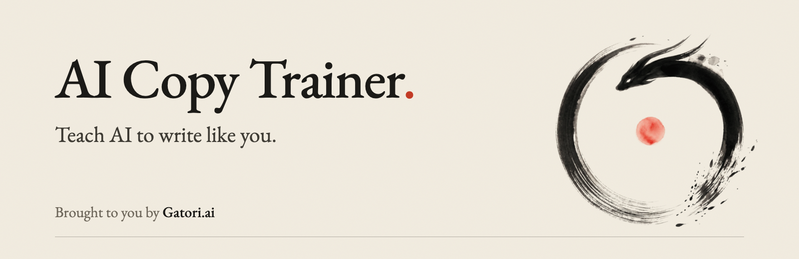
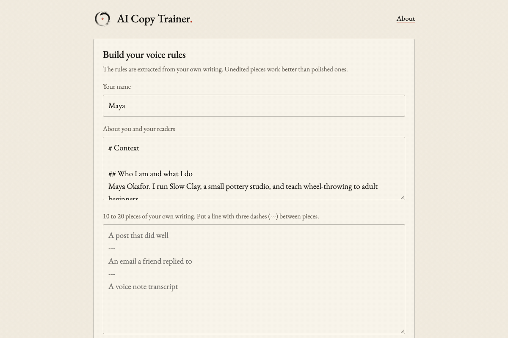
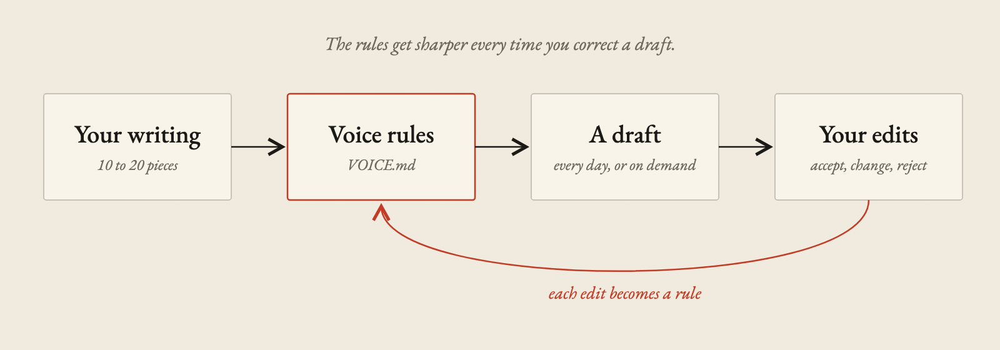

<p align="center">
  <picture>
    <source media="(prefers-color-scheme: dark)" srcset="assets/banner-night.png">
    
  </picture>
</p>

AI Copy Trainer reads your own writing, writes down the rules of how you sound, and sharpens those rules every time you edit a draft. It writes one new draft every day and tells you when it is ready.

It writes tweets, threads, LinkedIn posts, Instagram captions, email broadcasts and long-form paragraphs. You can add formats of your own.

<p align="center"></p>

| If you are | Start with |
|---|---|
| A person who wants to try it | [Quick start](#quick-start), or the about page at `/about` once the page is running |
| An AI agent asked to train someone's voice | [AGENTS.md](AGENTS.md) |
| An AI agent asked to change this project | [AGENTS.md, "Working on the code"](AGENTS.md#working-on-the-code) |

## Quick start

You need Node 20 or later.

**Look around first, with a sample person and no AI account:**

```
node bin/trainer.mjs demo
```

**Use it for yourself, on the local page.** You need one of Claude Code, Codex, or an Anthropic API key.

```
node bin/trainer.mjs serve
```

Open http://localhost:4747. Paste your writing, press **Build my voice rules**, then press **New draft** whenever you want one. Edit the text in place, add a note, and choose Accept, Rewrite it or Reject.

**Use it inside your agent.** Open this folder in Claude Code, Codex, or any agent that reads files, and say:

> Read AGENTS.md and start.

The agent interviews you, collects your samples, writes your rules and gives you a first draft. Keep one project or chat for this. Each time you come back it shows you the waiting draft, takes your feedback and updates the rules.

## How it learns

<p align="center">
  <picture>
    <source media="(prefers-color-scheme: dark)" srcset="assets/loop-night.png">
    
  </picture>
</p>

1. **Foundation.** Your context and 10 to 20 pieces of your writing go in. `voice/VOICE.md` comes out, with a quote from your writing behind each rule.
2. **Draft.** A piece is written from the rules, your context and the drafts you already approved. A mechanical check catches the habits that mark writing as machine-made.
3. **Feedback.** Your edits and notes are compared with the draft. Changes that would apply to future pieces become rule changes. Each one is recorded in `voice/LOG.md` with the draft that caused it.
4. **Daily.** One new draft per day, rotating through your formats, taking the next idea from `voice/topics.md`.

## The daily draft

While the page is running, the draft is written at the time set in `voice/config.json` (`daily.time`, default 08:00) and a desktop notification is sent.

To get the draft with the page closed:

```
node bin/trainer.mjs schedule install --time 08:00
```

On macOS this installs a daily job. On Linux and Windows it prints the line to add to your scheduler. `node bin/trainer.mjs schedule remove` takes it out.

Other ways to be notified:

- Any service that accepts a JSON POST (Slack, Discord, ntfy, Make, Zapier): set `notify.webhook` in `voice/config.json`.
- Telegram: set the environment variables `TELEGRAM_BOT_TOKEN` and `TELEGRAM_CHAT_ID`.

## Commands

| Command | What it does |
|---|---|
| `node bin/trainer.mjs demo` | The page with a sample person and canned drafts |
| `node bin/trainer.mjs serve` | The page for your own voice folder |
| `node bin/trainer.mjs init --name "Your Name"` | Create the `voice/` folder |
| `node bin/trainer.mjs foundation` | Build `voice/VOICE.md` from `context.md` and `samples/` |
| `node bin/trainer.mjs draft --format email-broadcast --topic "..."` | Write one draft now |
| `node bin/trainer.mjs list` and `show <id>` | See drafts |
| `node bin/trainer.mjs accept <id> --file edited.txt --note "..."` | Keep a draft; edits and the note update the rules |
| `node bin/trainer.mjs rewrite <id> --note "..."` | Learn from the note, then write a replacement |
| `node bin/trainer.mjs reject <id> --note "..."` | Throw a draft out; the note updates the rules |
| `node bin/trainer.mjs daily` | Today's draft, once per day, with a notification |
| `node bin/trainer.mjs schedule install` and `remove` | The daily job |
| `node bin/trainer.mjs check some-text.md` | Check any text against the rules |
| `node bin/trainer.mjs status` | Where things stand, as JSON |

Formats: `tweet`, `thread`, `linkedin-post`, `instagram-caption`, `email-broadcast`, `long-form`. Add your own under `customFormats` in `voice/config.json`.

## Which model writes

The first one found is used: a command you set, Claude Code (`claude`), Codex (`codex`), then the Claude API (`ANTHROPIC_API_KEY`, after `npm install`). To choose, set `writer.provider` in `voice/config.json` to `claude-cli`, `codex-cli`, `claude-api` or `command`. `writer.model` sets the model. With `command`, `writer.command` is any program that reads a prompt on standard input and prints the answer.

## Your files

Everything about you lives in `voice/`:

```
voice/
  context.md     who you are and who reads you
  samples/       your own writing
  VOICE.md       your rules
  drafts/        every draft and what it taught
  LOG.md         every rule change
  topics.md      your idea queue
  config.json    formats, daily time, writer, notifications
```

`voice/VOICE.md` is plain text. Load it, with `rules/ai-tells.md`, in any other tool that writes for you.

The page listens on your own computer only. Your writing goes to the model that writes the drafts and nowhere else. `voice/` is listed in `.gitignore`, so your writing stays out of this repository and out of any fork of it. To keep a history of your rules, put `voice/` in a private repository of its own, or point `VOICE_HOME` at a folder that already is one.

## Repository map

```
AGENTS.md        instructions for an AI agent (CLAUDE.md points to it)
bin/trainer.mjs  the command line
src/             engine (the loop and prompts), store (files), writer (models),
                 lint (the check), server (the page), notify, schedule
web/             the page, the about page, the Gatori Ink styles
rules/           the shipped list of AI tells
templates/       starting files for a new voice folder, and the formats
demo/            the sample person and canned writer behind "trainer demo"
assets/          banners, the loop diagram, the demo GIF
test/            npm test
```

## Tests

```
npm test
```

<p align="center">Brought to you by <a href="https://gatori.ai">Gatori.ai</a></p>
